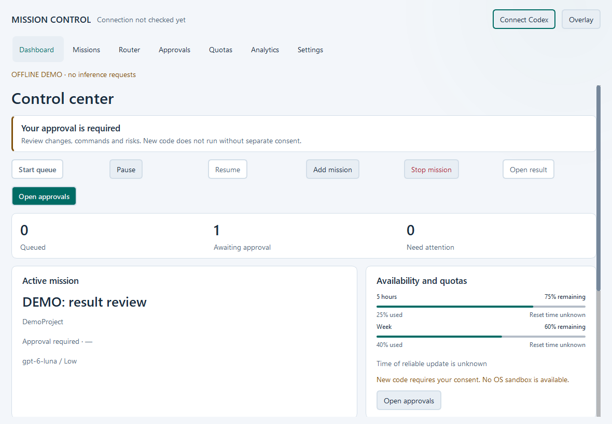

# Codex Mission Control

Stage 12 **Concept C Evolution** adds an action-first Dashboard,
Router inspection, mission search and explicit quota freshness.
See [changes, validation and before/after captures](docs/STAGE12.md).

[Русский](README.md) | **English**

An open-source command center for Codex workflows.

**v0.7.0 — Public Alpha / Early Development.** A Windows desktop application
for managing your own Codex missions, selecting models, monitoring available
limits, and reviewing generated project changes before execution.

This source snapshot includes completed development stages 1–10, RU/EN localization
and the Concept C Evolution interface (stage 12). Graceful
Pause & Resume (stage 11) is excluded from that published snapshot. The current development branch adds Stage 11 and checkpoint review to Evolution;
see [workflow and limitations](docs/STAGE11_INTEGRATION.md). The first
public version is 0.7.0; earlier private version numbers did not indicate public maturity.

## Screenshots



See [the screenshot gallery](docs/SCREENSHOTS.md). Images show the actual Qt
application with explicitly labelled offline demonstration data. They are not
evidence of live inference, account connectivity, or performance.

## Features

- Smart Model Router with economy, balanced and quality strategies, supported
  reasoning levels and bounded escalation after validated quality failures.
- Model Policy: disable individual models and limit their reasoning effort.
- Durable Mission Queue with dependencies, priorities and recovery checks.
- Five-hour and weekly limit tracking when the server supplies that information.
- Credit policies and separate quota reserves. Paid continuation is unsupported;
  client-side gates cannot guarantee that no credits will be charged.
- Managed sessions that reconcile uncertain outcomes rather than blindly replaying work.
- Security approvals and isolated result review before running new project code.
- Native Windows desktop, compact overlay and local observation-based analytics.
- SQLite storage protected with Windows DPAPI and password-encrypted portable summaries.

The controller operates locally. Sending a mission invokes the separately installed
Codex service and can consume your account's limits. There are no automatic purchases,
credit resets, subscription changes or cloud infrastructure operated by this project.

## Installation

Source installation only for this alpha. No public installer or GitHub Release is provided.
Use Windows 10 version 2004 or later / Windows 11, 64-bit Python 3.12+, Git, and a
separately installed Codex CLI with App Server support. Authenticate Codex yourself
with its supported login flow. The interface supports Russian (default) and English.
Choose **Settings → Interface language → English** or select English in the first-run
wizard. The change applies immediately and is saved for subsequent launches.
See [localization details and screenshots](docs/LOCALIZATION.md#english).

```powershell
git clone https://github.com/RegulusQuagmire/codex-mission-control.git
cd codex-mission-control
python -m venv .venv
.\.venv\Scripts\python.exe -m pip install -e ".[desktop]"
.\.venv\Scripts\mission-control-desktop.exe
```

Use an installed Python executable if the Windows Store alias is unavailable.
Do not put credentials in this repository. No API key is required by the controller;
authentication is handled by your Codex installation. App Server compatibility may
change between Codex versions; connectivity checks do not prove inference availability.

## Getting started

1. Install from source and launch the desktop application.
2. Use the setup flow to locate Codex and check its connection.
3. Choose a project directory and explicitly grant the required local access.
4. Create a mission and choose a routing strategy or allowed manual model.
5. Review quota reserves, credit policy and security settings before starting.
6. Start the mission. This step can consume Codex limits.
7. Inspect its result and validation evidence; approve execution only after review.

See [the desktop guide](docs/DESKTOP.md) and [mission queue guide](docs/MISSION_QUEUE.md).

## How it works

PySide6 presents the desktop UI. An asynchronous bridge calls the queue, router,
limit manager and safety checks. The adapter communicates with Codex App Server
over stdio JSON-RPC. Codex owns authentication and its own thread history; this
application stores local mission state and validation evidence.

See [architecture](ARCHITECTURE.md) and [security](SECURITY.md).

## Security and limitations

DPAPI protects selected persisted data for the current Windows user; it does not
protect an unlocked session or a compromised user account. Runtime journals and
project files can contain private prompts and results. Keep them out of Git.
There is no OS sandbox and no guarantee of safe execution of untrusted code.
Approvals, directory checks and recovery checkpoints have limited scopes.
Do not control the same Codex thread concurrently from another client.

Unknown or exhausted applicable limits block new submissions. Already running
turns use bounded cooperative steer/interrupt requests in this integration;
an RPC acknowledgement does not prove termination or undo effects. Quota cost per task and savings
percentages are not known. [Security details](docs/SECURITY_HARDENING.md).

## Roadmap

See [ROADMAP.md](ROADMAP.md). Stage 11 checkpoint review is integrated in the development branch;
routing upgrades and project orchestration remain future work. This source update
does not create a new release or change the historical v0.7.0 snapshot.

## Development and contributing

```powershell
.\.venv\Scripts\python.exe -m pip install -e ".[desktop,dev]"
.\.venv\Scripts\python.exe -m pytest -q
```

The automated suite uses local fakes and does not require Codex authentication
or inference. Read [testing](docs/TESTING.md), [building](docs/BUILDING.md),
[CONTRIBUTING.md](CONTRIBUTING.md) and [CHANGELOG.md](CHANGELOG.md).

## License

Original project code is licensed under the [MIT License](LICENSE).
Dependencies retain their own licenses; see [THIRD_PARTY_NOTICES.md](THIRD_PARTY_NOTICES.md).

## Disclaimer

An independent, unofficial project. It is not developed, endorsed, supported by,
or affiliated with OpenAI. Codex and OpenAI names identify the external service.
