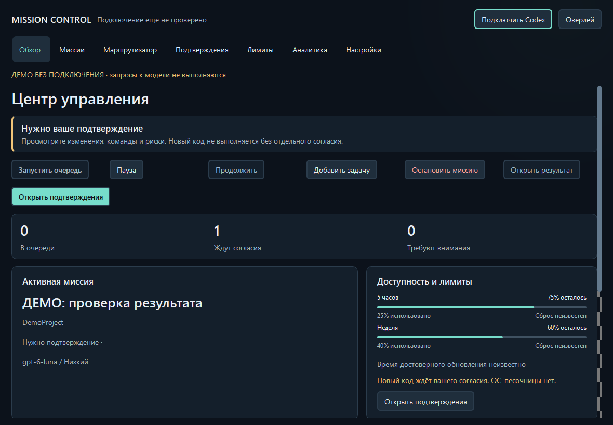

# Codex Mission Control

Локальная ветка Stage 13 добавляет Intelligent Router 2.0: объяснимую оценку задачи,
осторожное использование проверенной истории и инспекцию миссии без inference.
[Алгоритм, сценарий и ограничения](docs/STAGE13.md). Публичная версия не изменяется.

**Русский** | [English](README.en.md)

Открытый центр управления задачами Codex.

**v0.7.0 — Public Alpha / ранняя разработка.** Приложение для Windows,
которое помогает управлять задачами Codex, выбирать модели, следить за доступными
лимитами и проверять изменения проекта перед запуском сгенерированного кода.

В публичную версию входят завершённые этапы разработки 1–10, локализация RU/EN
и обновлённый интерфейс Concept C Evolution (этап 12). Приостановка и
возобновление задач (Graceful Pause & Resume, этап 11) в опубликованный снимок
не включены. Текущая ветка разработки добавляет Stage 11 и просмотр
checkpoint в Evolution; [сценарий и ограничения](docs/STAGE11_INTEGRATION.md).
Это обновление исходного кода; отдельный релиз не создаётся. Первая публичная версия — 0.7.0; прежние внутренние номера
версий не отражали готовность продукта к публичному использованию.

## Скриншоты



Интерфейс приложения доступен на русском и английском. Русский включён по умолчанию;
выбор языка в настройках или мастере первого запуска применяется сразу и сохраняется.
Смотрите [локализацию и примеры обоих языков](docs/LOCALIZATION.md).

Интерфейс **Concept C Evolution**: центр действий на
Dashboard, инспекция Router, поиск миссий и более ясные состояния лимитов.
[Изменения, проверки и снимки до/после](docs/STAGE12.md).

Смотрите [галерею скриншотов](docs/SCREENSHOTS.md) (на английском). На изображениях —
настоящее приложение Qt с явно отмеченными демонстрационными данными.
Они не подтверждают выполнение реальных запросов к модели, подключение аккаунта
или показатели производительности.

## Возможности

- Smart Model Router: экономичная, сбалансированная и качественная стратегии,
  поддерживаемые уровни reasoning и ограниченное повышение модели после
  подтверждённых ошибок качества.
- Политика моделей: отключение отдельных моделей и ограничение reasoning effort.
- Сохраняемая очередь задач с зависимостями, приоритетами и проверками восстановления.
- Отслеживание пятичасовых и недельных лимитов, если сервер предоставляет эти данные.
- Политики кредитов и отдельные резервы квоты. Платное продолжение не поддерживается;
  проверки на стороне клиента не гарантируют отсутствие списаний кредитов.
- Управляемые сессии: сверка неопределённых результатов перед повторным выполнением.
- Подтверждения безопасности и отдельная проверка результата перед запуском нового кода.
- Нативное приложение Windows, компактный оверлей и локальная аналитика наблюдений.
- Хранение в SQLite с защитой Windows DPAPI и переносимые сводки с шифрованием паролем.

Контроллер работает локально. Отправка задачи обращается к отдельно установленному
сервису Codex и может расходовать лимиты вашего аккаунта. Проект не выполняет
автоматические покупки, сбросы кредитов или смену подписки и не использует собственную
облачную инфраструктуру.

## Установка

В этой альфа-версии доступна только установка из исходников. Публичного установщика
и GitHub Release пока нет. Требуются Windows 10 версии 2004 или новее / Windows 11,
64-разрядный Python 3.12+, Git и отдельно установленный Codex CLI с поддержкой
App Server. Войдите в Codex самостоятельно через поддерживаемый им способ входа.
Язык интерфейса можно изменить в разделе «Настройки → Язык интерфейса».

```powershell
git clone https://github.com/RegulusQuagmire/codex-mission-control.git
cd codex-mission-control
python -m venv .venv
.\.venv\Scripts\python.exe -m pip install -e ".[desktop]"
.\.venv\Scripts\mission-control-desktop.exe
```

Если псевдоним Python из Windows Store недоступен, укажите путь к установленному
интерпретатору. Не сохраняйте учётные данные в репозитории. Контроллеру не нужен
API-ключ: авторизацией управляет установленный Codex. Совместимость App Server
может меняться между версиями Codex; проверка подключения не подтверждает
доступность выполнения запросов к модели.

## Первый запуск

1. Установите приложение из исходников и запустите его.
2. В мастере настройки укажите Codex и проверьте подключение.
3. Выберите каталог проекта и явно предоставьте необходимый локальный доступ.
4. Создайте задачу и выберите стратегию маршрутизации или разрешённую модель вручную.
5. Проверьте резервы квоты, политику кредитов и настройки безопасности.
6. Запустите задачу. Этот шаг может расходовать лимиты Codex.
7. Изучите результат и подтверждения проверок; разрешайте запуск кода после просмотра.

Подробнее: [руководство по приложению](docs/DESKTOP.md) и
[руководство по очереди задач](docs/MISSION_QUEUE.md).

## Как это работает

Интерфейс построен на PySide6. Асинхронный мост обращается к очереди, маршрутизатору,
менеджеру лимитов и проверкам безопасности. Адаптер взаимодействует с Codex App Server
через stdio JSON-RPC. Codex управляет авторизацией и собственной историей потоков;
приложение хранит локальное состояние задач и результаты проверок.

Подробнее: [архитектура](ARCHITECTURE.md) и [безопасность](SECURITY.md)
(на английском).

## Безопасность и ограничения

DPAPI защищает отдельные сохраняемые данные для текущего пользователя Windows,
но не защищает разблокированную сессию или скомпрометированный аккаунт.
Рабочие журналы и файлы проектов могут содержать частные запросы и результаты.
Не добавляйте их в Git. Песочницы на уровне ОС нет; безопасное выполнение
недоверенного кода не гарантируется. Подтверждения, проверки каталогов и точки
восстановления имеют ограниченную область действия. Не управляйте одним потоком
Codex одновременно из другого клиента.

Неизвестные или исчерпанные применимые лимиты блокируют отправку новых задач.
Проверка кредитов из этапа 10 блокирует новую отправку. В интеграции
Stage 11 активный ход получает ограниченные запросы steer/interrupt; ACK не
доказывает завершение хода, остановку процессов или отмену выполненных действий.
Стоимость задачи в единицах квоты и процент экономии неизвестны.
Подробнее — [усиление безопасности](docs/SECURITY_HARDENING.md).

## Планы развития

Смотрите [ROADMAP.md](ROADMAP.md) (на английском). Приостановка и возобновление,
улучшения интерфейса и маршрутизации, а также оркестрация проектов относятся
к будущим работам и не входят в возможности этой альфа-версии.

## Разработка и участие

```powershell
.\.venv\Scripts\python.exe -m pip install -e ".[desktop,dev]"
.\.venv\Scripts\python.exe -m pytest -q
```

Автоматические тесты используют локальные имитации сервисов и не требуют
авторизации Codex или реальных запросов к модели. Документы на английском:
[тестирование](docs/TESTING.md), [сборка](docs/BUILDING.md),
[участие в разработке](CONTRIBUTING.md) и [история изменений](CHANGELOG.md).

## Лицензия

Собственный код проекта распространяется под [лицензией MIT](LICENSE).
Зависимости сохраняют свои лицензии; см. [THIRD_PARTY_NOTICES.md](THIRD_PARTY_NOTICES.md).

## Статус проекта

Это независимый неофициальный проект. Он не разрабатывается, не одобряется
и не поддерживается OpenAI и не связан с компанией. Названия Codex и OpenAI
используются для обозначения внешнего сервиса.
