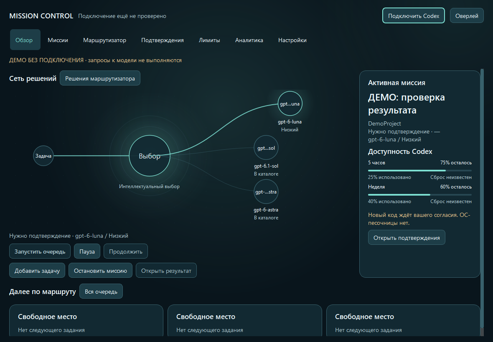
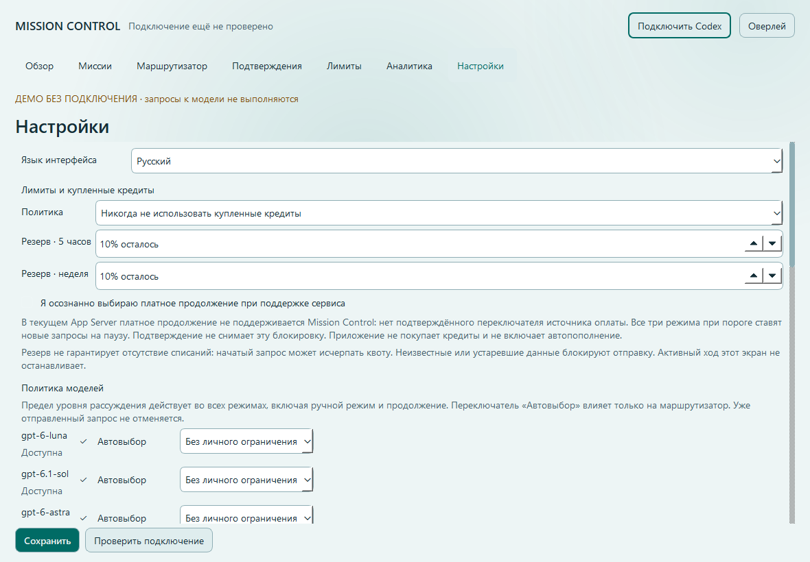
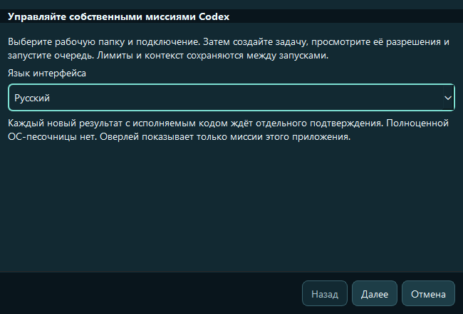
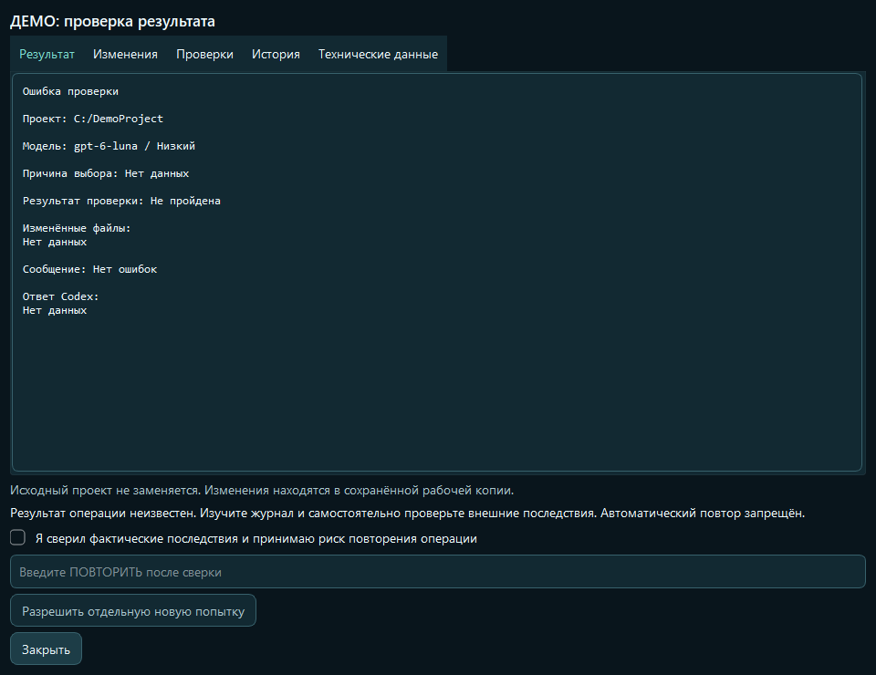
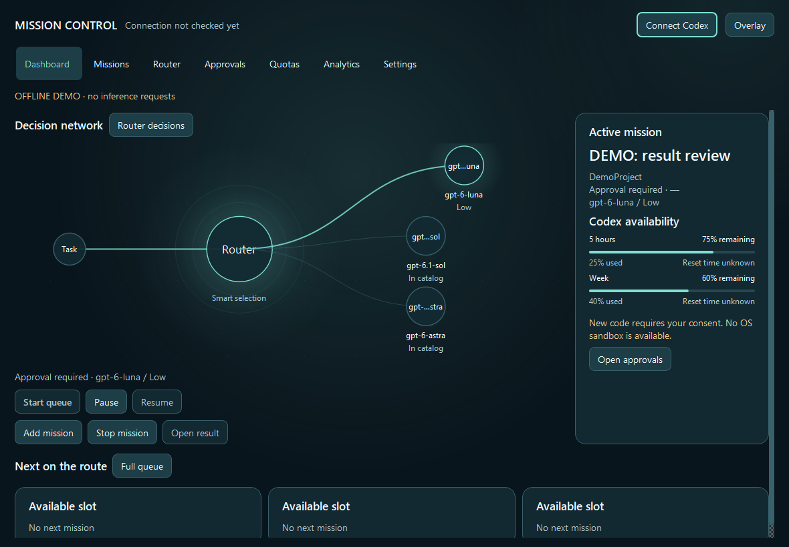
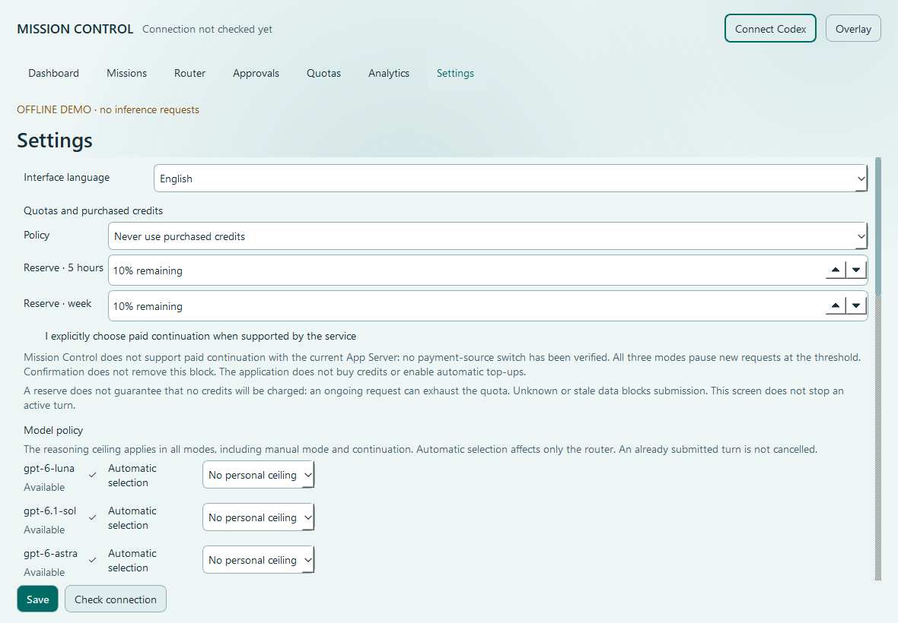
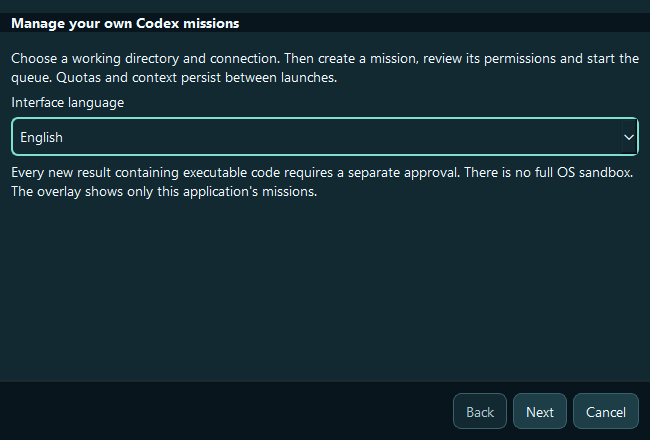
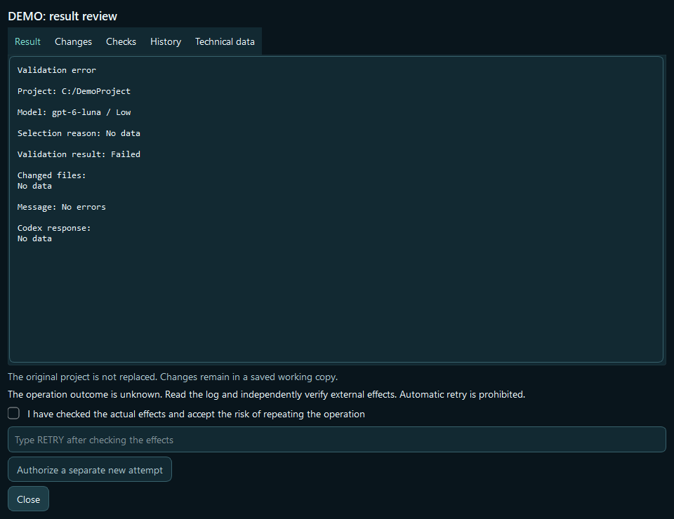

# Локализация интерфейса RU / EN

**Русский** | [English](#english)

Новая установка запускается на русском. В разделе **Настройки → Язык интерфейса**
можно выбрать **English**. Такой же переключатель доступен в мастере первого запуска.
Выбор сохраняется сразу; перезапуск не требуется. Несохранённые поля настроек,
содержимое задач и подтверждения безопасности при переключении сохраняются.

Переведены семь основных страниц, мастер настройки, диалоги задач и проверок,
трей, оверлей, политики моделей и кредитов, статусы, известные ошибки контроллера
и предупреждения. Стандартные элементы Qt используют русский каталог Qt.

Имена моделей, Astra / Sol / Luna, команды, пути, JSON, исходный код, diff,
пользовательские задания и ответы сервиса сохраняются в исходном виде.
Неизвестные внешние диагностические сообщения также показываются без преобразования.

## Настоящие скриншоты Windows

Снимки получены из нативных виджетов PySide6 на Windows с синтетическими данными.
На них нет реального подключения, выполнения запросов или измерений производительности.

### Русский

### English

Russian is the default language. Select **Settings → Interface language → English**
or use the language selector in the first-run wizard. The selection is saved immediately
and updates open application widgets without restarting or discarding user edits.

All application pages, dialogs, tray and overlay use a shared RU/EN catalog.
Model IDs, commands, paths, protocol data, user content, service responses and unknown
external diagnostics retain their original text. These native Windows screenshots use
synthetic offline data; no model requests were made to capture them.

## Для разработчиков / For contributors

- Каталог: `src/mission_control/desktop/translations.json`, обе записи `ru` и `en`
  обязательны. Именованные параметры должны совпадать.
- `i18n.tr()` переводит только явные строки приложения. `LocalizedText` сохраняет
  выражение до отображения; параметры и пользовательские строки остаются непрозрачными.
- `localized_widgets` обновляет текст через Qt-сигнал, не пересоздавая формы.
  Для списков отображаемая подпись отделена от технического значения `userData`.
- `language` — добавочная настройка `ru` / `en`; старые записи без этого поля
  получают `ru`. Системные статусы и существующие ключи не меняются.
- Неизвестный ключ отображается как `[key]`; отсутствующий перевод языка
  предсказуемо использует русский вариант. Тесты запрещают пропуски в основном каталоге.
- `python -m pytest tests/test_localization.py -q` проверяет локализацию,
  сохранение данных и безопасность переключения.
- `python tools/capture_localization.py` снимает 72 изображения настоящего Windows GUI:
  RU/EN, обе темы, семь страниц, диалоги, оверлей, трей и окно 800 × 580.
  Вывод по умолчанию: `.local/localization-qa`; backend не запускается.

Архитектура и визуальный стиль Concept C сохранены. Эта работа не включает этапы 11 и 12.

## Проверка / Validation

Локальная проверка Windows от 2026-10-12:

- Полный набор: **459 passed, 1 skipped** (257,76 с). Пропущена проверка
  символической ссылки из-за отсутствия соответствующего права Windows.
- Тесты локализации: **18 passed**; независимое ревью завершено без нерешённых замечаний.
- Native Windows GUI: 72 снимка RU/EN, обе темы; ошибок Qt и запросов backend нет.
- Запуски из исходников и локальной сборки Windows: RU/EN восстановлены из настроек,
  русский каталог стандартных элементов Qt загружается.
- Wheel и sdist содержат каталог переводов; `compileall`, `pip check`,
  `git diff --check` и проверка дерева Gitleaks пройдены.

Проверки не отправляли реальные inference-запросы и не использовали платные кредиты.
Локальная сборка служит проверкой упаковки; установщик и GitHub Release не создавались.
Hosted CI для этих изменений до публикации не запускался.
## Local Stage 11 additions

Checkpoint review and factual stop/continuation labels are RU/EN developer-owned text.
Checkpoint/model output, turn/thread IDs, JSON and user text stay opaque. Live language
changes neither grant consent nor change its turn binding. See [integration](STAGE11_INTEGRATION.md).
