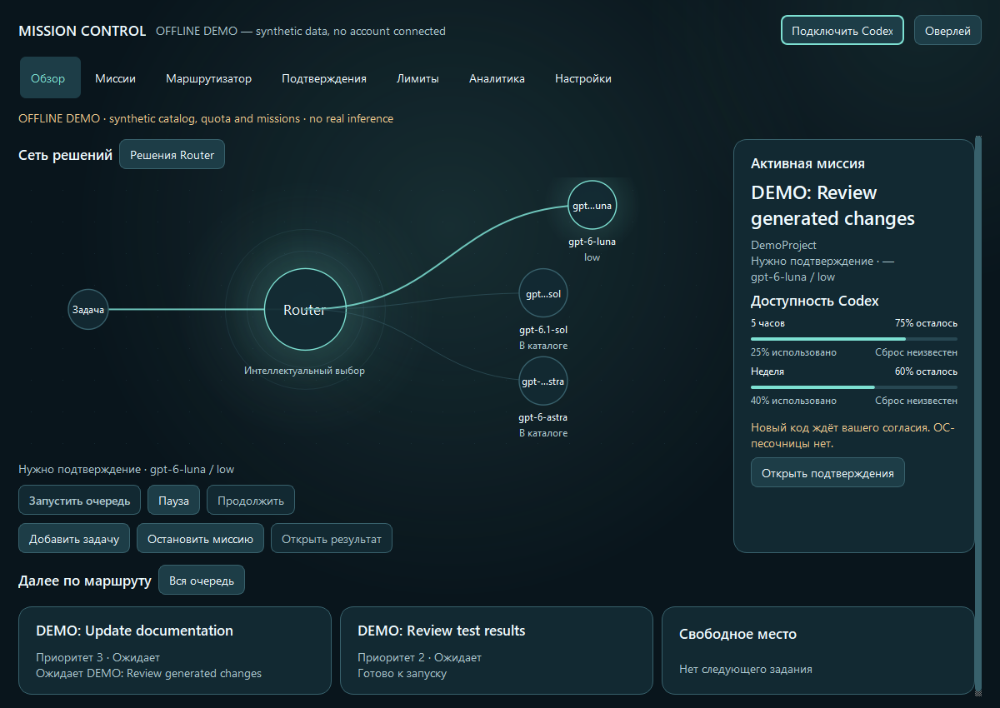
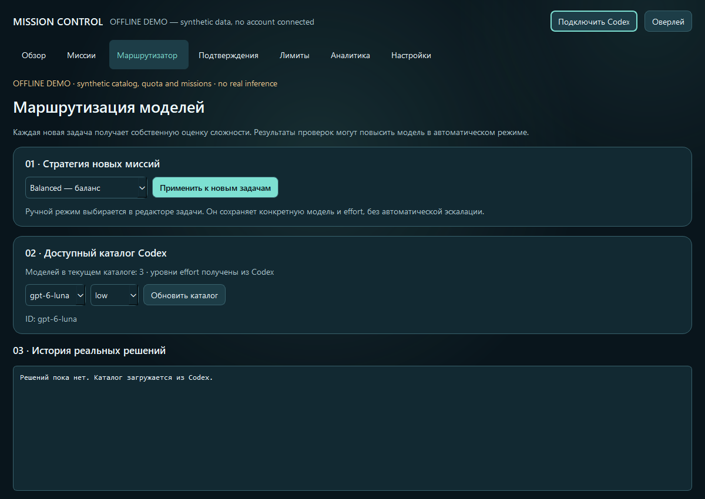
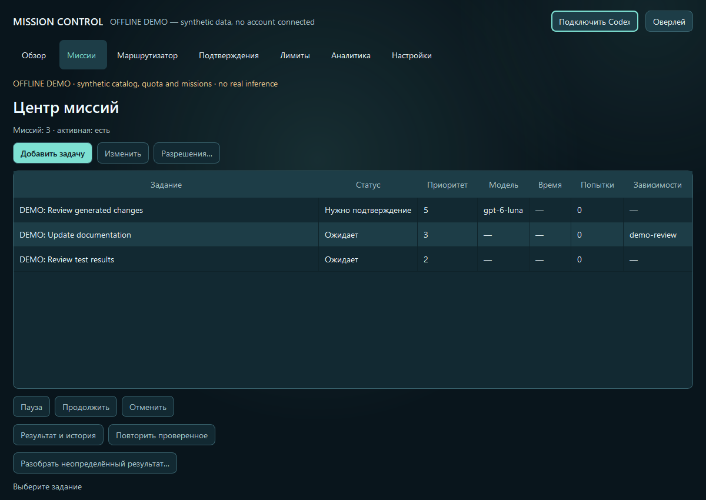
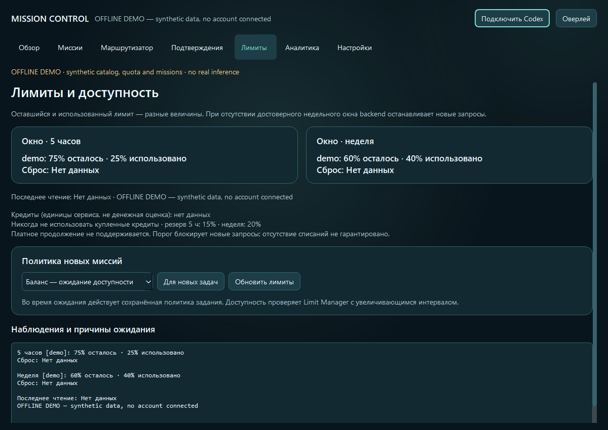
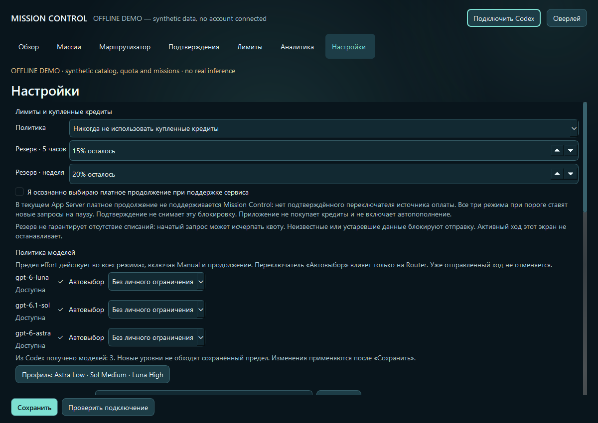
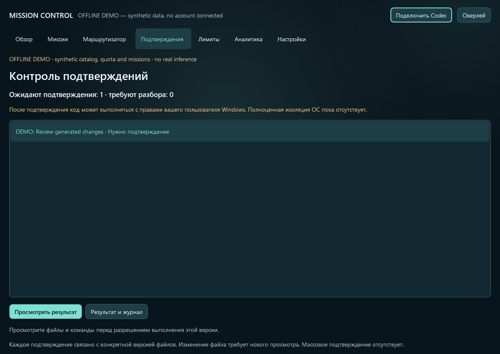
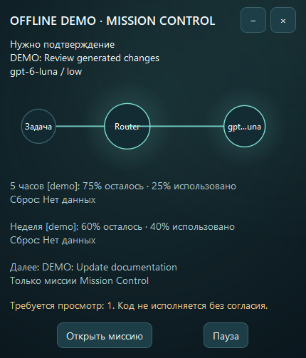

# Screenshot gallery

These are captures of the actual v0.7.0 Qt Widgets application using the native
Windows platform. Every image uses explicitly labelled offline fixtures: the catalog,
quota percentages and missions are synthetic. No real account is connected, no backend
request is sent and no inference or generated-code execution occurs.
Reproduce with `python tools/capture_public_demo.py docs/images` after installing
`.[desktop,dev]`. The application UI is currently primarily Russian.

## Dashboard

## Smart Router

## Mission Queue

## Model Policy

## Limit Manager

## Credit policy

## Security approval

## Overlay

