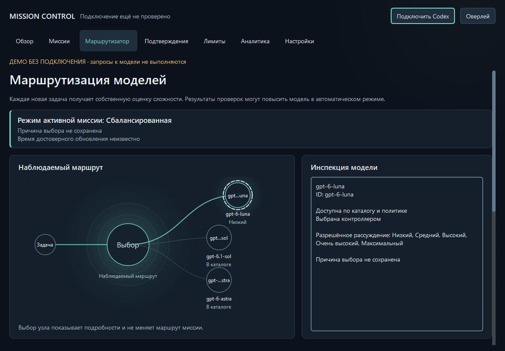
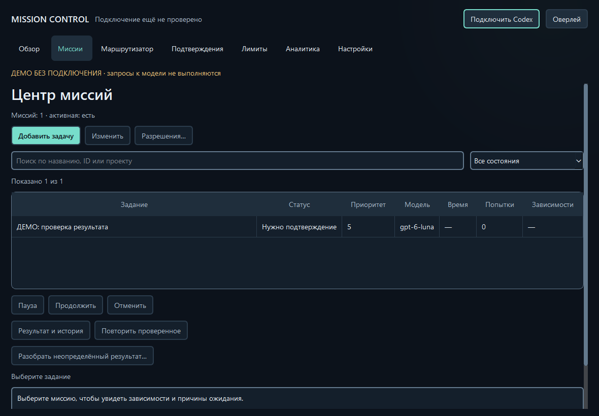
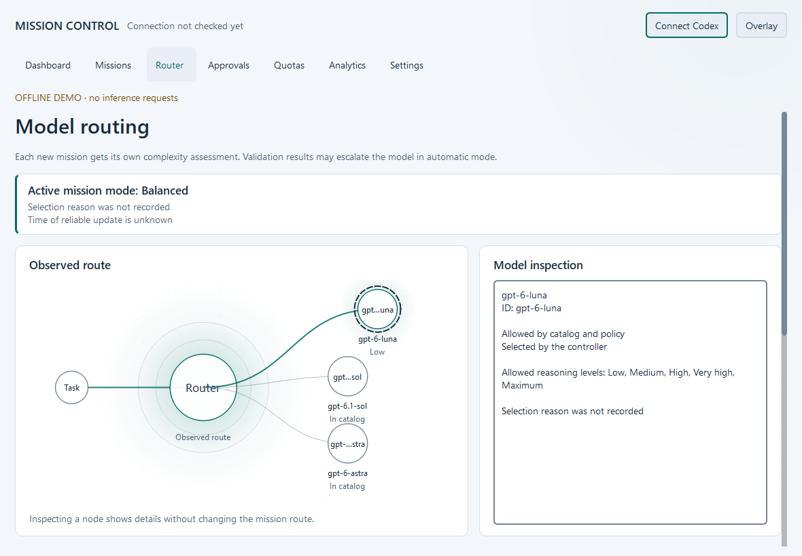

# Concept C Evolution — этап 12

**Concept C Evolution: публикация исходников одобрена владельцем после проверки CI.**
Основа — публичный main `f9c58f164b96bd899ca6cf0c56c023785ec4778c`,
содержащий локализацию RU/EN. Этап 11 не перенесён. Версия остаётся 0.7.0 Public Alpha.

## Что изменилось

- Dashboard начинает с состояния системы, необходимого действия и реальных счётчиков
  очереди. Активная миссия, причина назначения модели и достоверность лимитов находятся
  выше графа. Пустые карточки очереди убраны.
- Router позволяет инспектировать узлы мышью и клавиатурой. Текстовый каталог
  показывает все модели, ограничения существующей политики и пропавшую сохранённую
  модель. Инспекция не назначает модель и не отправляет запрос. Граф компактно показывает
  до трёх узлов; полный каталог доступен через обычный селектор.
- Missions получила поиск по названию, ID и проекту, фильтр состояния, названия зависимостей
  и подробности выбранной миссии. Скрытая фильтром миссия не остаётся целью команды.
  В узком окне вторичные колонки скрываются; детали сохраняются ниже таблицы.
- Limits отличает неизвестное время чтения, устаревшие данные и свежие наблюдения.
  Неизвестный остаток не превращается в ноль. Предупреждение об отсутствии гарантии
  запрета списаний кредитов сохранено.
- Approvals подчёркивает просмотр конкретной версии и риски исполнения с правами
  пользователя. Завершённые зависимости разрешаются по полному снимку очереди.
- Analytics использует компактную сводку фактических показателей. Settings,
  onboarding, диалоги, трей и overlay используют общую тему; overlay также показывает
  приоритетное состояние и достоверность лимитов.

Сохранены семь разделов навигации и нативное окно Windows. Тёмная палитра сланцевая,
светлая — самостоятельная холодная нейтральная палитра; бирюзовый акцент обозначает
действия и маршрут. Центральные токены и общие компоненты задают поверхности,
типографику, состояния и адаптивную компоновку. Бизнес-обработчики и bridge сохранены.

Переходы страницы и баннера занимают 160 мс, подсветка изменения маршрута — 750 мс.
Постоянной декоративной анимации нет. Reduced motion останавливает переходы,
подсветку и анимацию квот. Неподтверждённая остановка явно остаётся запросом остановки.
Отсутствующие причины выбора альтернатив обозначены как несохранённые данные.

## Проверка

- Полный regression suite: **471 passed, 1 skipped**; пропуск — недоступное право
  создания symlink в Windows. Новые тесты покрывают приоритет состояний, свежесть
  лимитов, ограничения каталога, дубли ID, адаптацию, поиск, безопасность инспекции,
  ручной режим, исчезнувшую модель и завершённые зависимости.
- Независимое ревью нашло три ошибки отображения; все исправлены и повторно проверены.
  Политики подтверждений, лимитов, SQLite и протокол App Server не менялись.
- **214 настоящих Qt-снимков Windows**, RU/EN × Dark/Light, страницы и диалоги,
  800×600, 960×740, 1920×1080. Отдельно проверены отсутствие подключения/моделей,
  неизвестные/исчерпанные/устаревшие лимиты, пустая очередь, 1000 миссий, ошибка,
  неопределённый результат, очередь на паузе и неподтверждённая отмена.
- Qt scale factors 1, 1.25, 1.5 и 2 проверены в отдельных процессах. Это проверка
  масштабирования Qt, **не изменение системного DPI Windows**.
- На текущем компьютере: обновление снимка с 1000 миссий ≈55 мс; простой 0–0.4%
  одного ядра, рабочая память 106–110 MiB, пик 119 MiB. Максимальный интервал
  25-мс heartbeat в коротком измерении простоя — 50 мс. При включённых анимациях
  после завершения переходов измеренная нагрузка простоя — 0% за четыре секунды.
  Это короткие наблюдения на одном компьютере, не гарантия для слабого оборудования.
- Чистый локальный clone собрал wheel/sdist с каталогом переводов и новыми компонентами;
  приложение запустилось на RU и EN со всеми семью страницами. Gitleaks не нашёл секретов
  в исходниках и Git-истории. Зависимости и MIT не изменены.

GUI-пробы работают только с явно демонстрационными snapshots и тестовым bridge.
Запуски чистой копии используют отдельные пустые очереди и не проверяют соединение.
Реальных inference-вызовов, расходов кредитов, Release или установщика нет.
Существующие regression tests дополнительно проверяют восстановление и безопасность
на mock App Server; успешный настоящий `turn/interrupt` здесь не подтверждается.

## До и после

До: [Dashboard RU](images/localization/ru-dark-dashboard.png),
[Router EN](images/stage12/before-en-light-router.png).

После — русская тёмная тема:

После — английская светлая тема:

Дополнительные снимки: [Approvals](images/stage12/ru-light-approvals.png),
[Limits](images/stage12/ru-dark-limits.png), [Settings](images/stage12/en-light-settings.png),
[Overlay](images/stage12/ru-dark-overlay.png), [неизвестные лимиты](images/stage12/unknown-limits.png),
[малое окно](images/stage12/small-dashboard.png),
[неподтверждённая отмена](images/stage12/cancel-requested.png).

Для повторения полного offline QA на Windows с dev/desktop зависимостями:
`python tools/capture_stage12.py`. Локальная галерея и машинные отчёты появляются
в `.local/stage12-qa/`; они не входят в публичную поставку целиком.

## English

Stage 12 evolves Concept C with an action-first Dashboard, read-only interactive Router
inspection, searchable mission queue, explicit quota freshness and consistent safety
surfaces. RU remains the default; EN remains complete. All seven destinations retain
their existing backend handlers. Finite transitions respect reduced motion.

Validation: 471 tests passed, one Windows symlink-privilege skip; independent review
findings fixed and rechecked; 214 native Qt captures; clean clone wheel/sdist and RU/EN
startup. Scaling was exercised through Qt factors, not by changing Windows display DPI.
No real inference, paid credits, installer or GitHub Release. Stage 11 stays separate.
The owner approved source publication subject to successful CI.
## Stage 11 integration follow-up

The preceding report describes published Stage 12 alone. Stage 11 is now integrated
with Evolution; its current regression and native Windows QA
must be evaluated separately. See [Stage 11 + Evolution](STAGE11_INTEGRATION.md).
